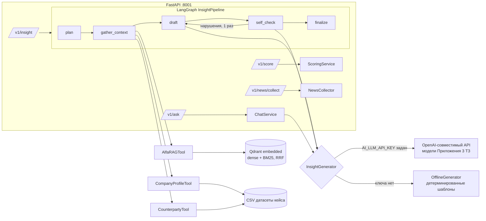

# 03. AI-Service — инсайты «Новость → Инсайт», чат, скоринг, сбор новостей, RAG по отчётам Альфа-Банка

> **Модуль Участника 3: AI / ML Engineer.** Отдельный FastAPI-сервис (порт `8001`), который
> вызывает `02-backend`. Спецификация и контракт — в `specs/001-ai-service/`.
> [Принципы сервиса](../specs/001-ai-service/principles.md) описывают требования к данным, API и проверкам.

## Что делает

| Возможность | Эндпоинт | Описание |
|---|---|---|
| Инсайт по 6 вопросам ТЗ | `POST /v1/insight` | новость + профиль компании + роль → `insight` (q1–q6), `card` (формат backend `Insight` 1:1), `importance`, `traceability` |
| Чат по карточке | `POST /v1/ask` | ответ в контексте новости, инсайта и отчётов банка; оффтоп и prompt-injection отбиваются |
| Скоринг важности | `POST /v1/score` | пакетная оценка 1–10 с объяснимыми факторами |
| Сбор новостей | `POST /v1/news/collect` | RSS ЦБ РФ, РБК, Интерфакс, Коммерсантъ → нормализация, дедуп, фильтр релевантности |
| Корпус отчётов | `GET /v1/reports`, `GET /v1/reports/search` | проиндексированные PDF банка и гибридный поиск с номером страницы |
| Состояние | `GET /health` | режим (`llm`/`offline`), модели, статус корпуса и OCR |

Полный контракт: [`specs/001-ai-service/contracts/openapi.yaml`](../specs/001-ai-service/contracts/openapi.yaml),
Swagger — `http://localhost:8001/docs`. Как backend вызывает сервис и что делает при ошибках:
[`contracts/backend-integration.md`](../specs/001-ai-service/contracts/backend-integration.md).

## Архитектура



- **Правила вместо галлюцинаций.** Сработавшие признаки компании (`CL_PRODUCT_LOA_MARK=1`,
  `FTS_FLAG=0`, …) вычисляет код (`agent/rules.py`), а не модель. Позиция банка берётся
  только из найденного фрагмента отчёта с дословной цитатой и страницей; иначе `null`.
- **Самопроверка.** `agent/checks.py` ловит упоминания признаков, которых у компании нет,
  числа, отсутствующие в источниках, и неподтверждённые цитаты; один повторный черновик с
  замечаниями, затем принудительная зачистка. Результат — в `traceability.self_check`.
- **Два режима, один граф.** Без ключа — `mode=offline` (детерминированно, для демо и
  тестов). С ключом — слоты `fast` (классификация, скоринг), `main` (черновик, чат),
  `checker` (самопроверка) через `langchain-openai` со structured output.
- **RAG.** PDF отчётов — сканы без текстового слоя, поэтому PyMuPDF → Tesseract OCR
  (`rus+eng`), кэш по sha256; чанки по предложениям, отсев «шума» графиков;
  fastembed `paraphrase-multilingual-MiniLM-L12-v2` + BM25 (`russian`) в embedded Qdrant,
  слияние RRF, ре-ранк по совпадению темы с названием отчёта.

## Быстрый старт

Нужны `uv` и Tesseract (`brew install tesseract tesseract-lang` или `apt install tesseract-ocr tesseract-ocr-rus`).

```bash
cd 03-ai-service
uv sync
./scripts/check.sh                    # ruff, mypy, pytest — без сети и без ключей

# данные кейса (не в git): PDF → data/articles/, CSV → data/datasets/
uv run ai-service index-reports       # OCR + индекс: 9 отчётов, 64 стр., ~3 мин первый раз
uv run ai-service search "ключевая ставка 14%"
uv run ai-service insight --sample key-rate --company U_1595 --role CFO --card-only
uv run uvicorn ai_service.main:app --port 8001 --reload
```

Демо-сэмплы: `src/ai_service/resources/sample/` (компании из сидов `04-infra-db`, новости,
готовые тела запросов `ask_request.json`, `score_request.json`). Пошаговая проверка всех
сценариев — [`specs/001-ai-service/quickstart.md`](../specs/001-ai-service/quickstart.md).

## Переменные окружения (`AI_*`)

Файл `.env` в корне репо или в `03-ai-service/`; все переменные необязательны.

| Переменная | По умолчанию | Назначение |
|---|---|---|
| `AI_LLM_API_KEY` | пусто → `offline` | ключ команды, хранится только в локальном `.env` / окружении сервера |
| `AI_LLM_BASE_URL` | `https://changellenge.up.railway.app/v1` | шлюз организаторов; резерв: `https://api.alfahack-gateway26.ru/v1` |
| `AI_LLM_MODEL_MAIN` / `_FAST` / `_CHECKER` | `qwen/qwen3.6-35b-a3b` / `google/gemma-4-26b-a4b-it` / `z-ai/glm-5.3-flash` | генерация и чат / планирование / самопроверка; разрешены только 6 точных ID из инструкции |
| `AI_LLM_TIMEOUT_S`, `AI_LLM_MAX_RETRIES`, `AI_LLM_MAX_TOKENS` | 60, 3, 4000 | лимиты одного вызова |
| `AI_LLM_REASONING_ENABLED` | `false` | reasoning для Qwen/GLM; отключение предотвращает обрыв JSON из-за thinking-токенов |
| `AI_INSIGHT_TIMEOUT_S`, `AI_CHAT_TIMEOUT_S` | 120, 90 | лимит на запрос целиком (→ 504 `llm_timeout`); HTTP-таймаут backend — 130 с. Внутри лимита: повтор сетевых сбоев, 5xx/429 и обрезанного JSON (`llm/retry.py`); сбой fast/checker-модели не роняет инсайт — применяются офлайн-план и правила |
| `AI_SCORE_LLM_ADJUST` | `true` | поправка ±1 моделью `fast` при скоринге |
| `AI_ARTICLES_DIR`, `AI_DATASETS_DIR`, `AI_INDEX_DIR` | `data/articles`, `data/datasets`, `data/index` | данные и индекс |
| `AI_EMBED_DENSE_MODEL`, `AI_EMBED_SPARSE_LANGUAGE` | MiniLM multilingual, `russian` | эмбеддинги |
| `AI_RAG_TOP_K`, `AI_RAG_MIN_SCORE` | 5, 0.45 | число фрагментов и порог «слабого retrieval» |
| `AI_OCR_LANG`, `AI_OCR_DPI` | `rus+eng`, 200 | OCR |
| `AI_NEWS_SOURCES_ENABLED` | `cbr_press,cbr_news,rbc,interfax,kommersant` | источники RSS (JSON-переопределение — `AI_NEWS_SOURCES_JSON`) |
| `AI_LOG_LEVEL`, `AI_LOG_FORMAT` | `INFO`, `json` | логи structlog (`console` для локали) |

## Качество и гейты

- `./scripts/check.sh` — единственный источник правды: ruff check/format, mypy strict, pytest
  (контрактные тесты по OpenAPI, граф на фейковых генераторах, RAG на фейковых эмбеддерах).
- `uv run python evals/run_eval.py` — eval на golden-наборе (`evals/golden.jsonl`, 24 пары
  новость × компания × роль): покрытие 6 блоков, обязательные/запрещённые признаки,
  точность темы, ролевой фокус, попадание нужного отчёта. Сравнение с `evals/baseline.json`,
  `exit 1` при регрессии. Обязателен при изменении промптов, моделей, retrieval или корпуса.
- Логи: событие `llm.call` на каждый вызов модели (слот, модель, токены, latency, request_id)
  без текстов промптов и ответов; `X-Request-ID` возвращается в ответе.

## Стоимость в режиме LLM

Один инсайт = 3 вызова (`fast` план ≈ 0,5k токенов, `main` черновик ≈ 4–6k входных /
≈ 1k выходных, `checker` ≈ 3k) плюс до одного повторного черновика; чат — 1 вызов
≈ 3k; скоринг — 1 вызов на пакет. [Прогноз] для flash-моделей это доли цента на карточку.

## Ограничения

- Корпус — сканы: качество цитат зависит от OCR; таблицы и графики распознаются плохо и
  отфильтровываются как «шум». Второй бэкенд (VLM Qwen3-VL из списка ТЗ) предусмотрен
  интерфейсом `PageTextBackend`, но не подключён.
- Offline-режим — шаблоны: честно помечен `mode: "offline"` (backend ставит `is_demo`).
- Сервис stateless: новости и инсайты хранит backend; статус «уже отдано» при сборе новостей
  передаётся параметрами `since` / `exclude_urls`.

## Docker

```bash
docker build -t alfa-ai-service:local .
docker run --rm -p 127.0.0.1:8001:8001 \
  -v "$PWD/data/articles:/data/articles:ro" -v "$PWD/data/datasets:/data/datasets:ro" \
  -v ai_index:/data/index alfa-ai-service:local
docker exec <container> ai-service index-reports   # один раз, индекс живёт в volume
```

Сниппет сервиса для общего `04-infra-db/docker-compose.yml` — в
[`contracts/backend-integration.md`](../specs/001-ai-service/contracts/backend-integration.md).
