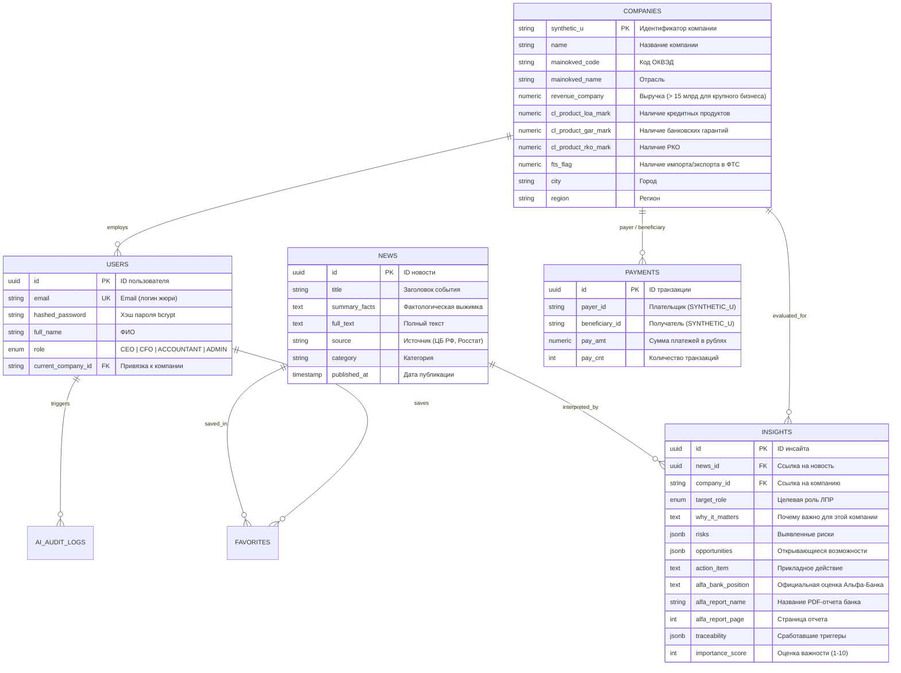

# 04. Infra & Database — Инфраструктура, База данных и Сидирование

> **Модуль Участника 4: DevOps & Database Engineer**  
> Проектирование реляционной схемы данных, контейнеризация проекта в Docker, автоматическое сидирование и подготовка демонстрационных данных для кейса «Альфа Будущее».

---

## 🏛 Схема базы данных (Entity-Relationship)



---

## 📁 Структура папки 04-infra-db

```text
04-infra-db/
├── docker-compose.yml       # Сборка multi-container: PostgreSQL 16, Backend, Frontend, Adminer
├── init.sql                 # DDL-скрипт инициализации PostgreSQL (типы, таблицы, индексы)
├── schema.sql               # Универсальная ANSI SQL схема (PostgreSQL + SQLite)
├── seed.py                  # Главный скрипт сидирования эталонными данными
├── db_check.py              # Диагностика доступности БД и проверка контрольных запросов
├── export_sample.py         # Выгрузка компактных сэмплов из тяжелых CSV (30+ МБ) в JSON
├── samples/                 # Легковесные JSON-сэмплы для других участников команды
│   ├── sample_companies.json
│   └── sample_payments.json
├── .env.example             # Конфигурация портов, подключения к БД и секретов
└── README.md                # Данная документация
```

---

## ⚡ Описание таблиц и полей данных

### 1. `companies` (Справочник клиентов)
Построен строго на основе структуры датасета `df_Uid_data_hack.csv`:
- `synthetic_u` — уникальный код компании (например, `U_1595`);
- `revenue_company` — годовая выручка (позволяет фильтровать сегмент крупного бизнеса с выручкой свыше 15 млрд руб. согласно стр. 4 ТЗ);
- `cl_product_loa_mark`, `cl_product_gar_mark`, `cl_product_rko_mark` — маркеры проникновения банковских продуктов;
- `fts_flag`, `fts_country_name` — данные Федеральной таможенной службы (импорт/экспорт).

### 2. `news` и `insights` (Концепция «Новость-Инсайт»)
Таблицы спроектированы для быстрой выдачи объединенных карточек в ленту:
- В таблице `insights` хранятся ответы на **6 обязательных вопросов кейса**:
  - `why_it_matters` — привязка к финансовым показателям и цепочке контрагентов;
  - `risks` и `opportunities` — структурированные JSON-массивы;
  - `alfa_bank_position` — позиция аналитиков Центра макроэкономических исследований;
  - `alfa_report_name` и `alfa_report_page` — прямая ссылка на официальный отчет Альфа-Банка;
  - `traceability` — трассируемость вывода (какие параметры компании повлияли на решение).

### 3. `ai_audit_logs` (Безопасность и мониторинг)
Реализует требование ТЗ (стр. 10 и 12) по аудиту и безопасности работы AI-компонентов: логирует пользователя, вызванную модель, затраченные токены и задержку ответа.

---

## 🚀 Инструкция по запуску

### Вариант 1: Полный запуск через Docker Compose (Рекомендуемый для демо)

1. Перейдите в папку `04-infra-db`:
   ```bash
   cd 04-infra-db
   ```
2. Скопируйте файл конфигурации:
   ```bash
   cp .env.example .env
   ```
3. Запустите контейнеры:
   ```bash
   docker compose up -d
   ```
   Будут запущены сервисы:
   - **PostgreSQL 16**: порт `5432`
   - **FastAPI Backend**: `http://localhost:8000` (Swagger: `/docs`)
   - **Web UI Frontend**: `http://localhost:3000`
   - **Adminer (DB Web GUI)**: `http://localhost:8080` (вход: система PostgreSQL, сервер `db`, логин `postgres`, пароль `postgres`, БД `alfa_news`).

---

### Вариант 2: Локальный запуск без Docker (SQLite Fallback)

Для мгновенной автономной разработки без необходимости поднимать Docker-контейнеры реализован автоматический fallback на локальный SQLite:

1. Запустите скрипт сидирования:
   ```bash
   python seed.py
   ```
   *Скрипт автоматически создаст базу `alfa_business.db`, применит схему и наполнит её эталонными компаниями, тестовыми пользователями и готовыми спаренными карточками «Новость-Инсайт».*

2. Проверьте работоспособность и тестовый запрос:
   ```bash
   python db_check.py
   ```

---

## 🔑 Тестовые учетные записи (для жюри и проверки ролей)

| Email / Логин | Пароль | Роль ЛПР | Привязанная компания |
|---|---|---|---|
| **`alfa-hack-2026`** *(аккаунт жюри)* | `password123` | **CEO** | `U_1595` (Ритейл, выручка 16.4 млрд ₽) |
| **`ceo@alfabusiness.ru`** | `password123` | **CEO** | `U_1595` |
| **`cfo@alfabusiness.ru`** | `password123` | **CFO** | `U_1595` |
| **`accountant@alfabusiness.ru`** | `password123` | **ACCOUNTANT** | `U_1595` |

---

## 📦 Сэмплы данных для команды (`samples/`)

В папке `04-infra-db/samples/` подготовлены готовые компактные JSON-файлы, экспортированные из исходных датасетов:
- **`sample_companies.json`**: 25 репрезентативных компаний (10 лидеров с выручкой > 15 млрд руб. + 15 компаний среднего бизнеса);
- **`sample_payments.json`**: 50 реальных транзакционных связей между контрагентами с суммами `PAY_AMT`.

Для обновления сэмплов из свежих CSV-файлов достаточно запустить:
```bash
python export_sample.py
```
