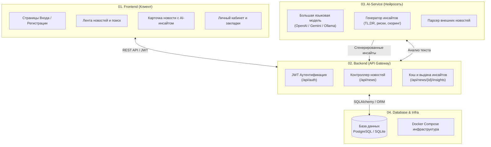

# Alfa News Insights 📰 🤖

> **Простой и современный веб-сервис новостей с аналитическими инсайтами от нейросети и системой авторизации.**

Сервис собирает и структурирует актуальные новости, автоматически генерирует для каждого материала емкие выжимки (TL;DR), оценивает риски и открывающиеся возможности с помощью нейросети, а также предоставляет полноценный личный кабинет с сохранением избранных материалов.

---

## 🏛 Архитектура проекта



---

## ⚡ Ключевые возможности

### 1. Авторизация и профиль пользователя
- Регистрация нового аккаунта и безопасный вход по email и паролю.
- Хэширование паролей (`bcrypt`) и защита эндпоинтов с помощью JWT-токенов (`Bearer Token`).
- Персональный профиль и список избранных новостей (Bookmarks), доступный только авторизованным пользователям.

### 2. Лента и каталог новостей
- Каталог свежих событий с фильтрацией по категориям (Бизнес, Финансы, Технологии, Рынки).
- Полнотекстовый поиск по заголовкам и содержанию.
- Удобная навигация и пагинация.

### 3. Интеллектуальные инсайты от нейросети (AI Insights)
Для каждого новостного материала нейросеть автоматически формирует:
- **TL;DR (Суть за 15 секунд)**: предельно краткая и емкая выжимка статьи.
- **Риски и угрозы**: на кого и как негативно может повлиять данное событие.
- **Возможности**: точки роста, новые ниши и потенциальные выгоды.
- **Оценка важности и тональность**: числовой скоринг (1–10) и сентимент (позитивный, нейтральный, негативный).
- **Интерактивный диалог**: возможность задать произвольный вопрос по новости нейросети.

---

## 👥 Структура проекта (4 рабочих пространства)

Репозиторий разделен на 4 независимые папки для комфортной параллельной работы 4 участников команды:

```text
Alfa_Hack/
├── 01-frontend/         # Участник 1: Frontend Developer
│   ├── README.md        # Задачи, экраны, компоненты UI
│   └── .gitkeep
│
├── 02-backend/          # Участник 2: Backend Developer
│   ├── README.md        # Спецификация REST API, JWT auth, роуты
│   └── .gitkeep
│
├── 03-ai-service/       # Участник 3: AI / ML Engineer
│   ├── README.md        # Промпты, интеграция с LLM, парсер
│   └── .gitkeep
│
├── 04-infra-db/         # Участник 4: DevOps & Database Engineer
│   ├── README.md        # Схема БД, миграции, docker-compose, сиды
│   └── .gitkeep
│
├── .env.example         # Шаблон переменных окружения
├── .gitignore           # Исключения репозитория
└── README.md            # Главная документация проекта
```

---

## 📋 Распределение задач по ролям

### 1. Frontend Developer (`01-frontend`)
- Верстка страниц авторизации (Login / Register) и подключение валидации.
- Главная страница: адаптивная сетка новостей, поисковая строка, фильтры категорий.
- Детальный экран новости с выделенным блоком **AI Insights** (акценты, бейджи тональности, список рисков/возможностей).
- Личный кабинет с сохраненными материалами.

### 2. Backend Developer (`02-backend`)
- Реализация JWT-аутентификации (`/api/auth/register`, `/api/auth/login`, `/api/auth/me`).
- CRUD операции с новостями, пагинация, фильтрация, поиск.
- Добавление новостей в закладки пользователя (`/api/news/{id}/favorite`).
- Интеграция с AI-сервисом и кэширование готовых инсайтов в базе данных.
- Автоматическая документация Swagger / OpenAPI по адресу `/docs`.

### 3. AI / ML Engineer (`03-ai-service`)
- Подключение провайдера LLM (OpenAI, Gemini, Groq или локальная Ollama).
- Разработка системных промптов с гарантированным структурированным JSON-ответом (`Pydantic` / Structured Output).
- Скрипт парсинга / сбора свежих новостей для регулярного пополнения базы.
- Функция интерактивного ответа на вопросы пользователя по контексту статьи.

### 4. DevOps & Database Engineer (`04-infra-db`)
- Проектирование реляционной схемы БД: `users`, `news`, `insights`, `favorites`.
- Настройка `docker-compose.yml` (Frontend, Backend, PostgreSQL, AI-Service).
- Скрипт сидирования (`seed_data.py`): предзаполнение базы 10–15 качественными новостями и инсайтами.
- Подготовка файлов окружения (`.env.example`) и инструкций по деплою.

---

## 🔌 Основные API эндпоинты

| Метод | Путь | Описание | Доступ |
|---|---|---|---|
| `POST` | `/api/auth/register` | Регистрация нового пользователя | Публичный |
| `POST` | `/api/auth/login` | Вход и получение JWT-токена | Публичный |
| `GET` | `/api/auth/me` | Данные текущего пользователя | Авторизованный |
| `GET` | `/api/news` | Список новостей (фильтры, поиск, пагинация) | Публичный |
| `GET` | `/api/news/{id}` | Детальная новость + AI-инсайт | Публичный |
| `POST` | `/api/news/{id}/favorite` | Добавить/удалить новость из избранного | Авторизованный |
| `POST` | `/api/news/{id}/ask-ai` | Задать вопрос нейросети по новости | Авторизованный |

---

## 🚀 Быстрый старт

### 1. Клонирование репозитория
```bash
git clone https://github.com/bboymonster/Alfa_Hack.git
cd Alfa_Hack
```

### 2. Настройка переменных окружения
```bash
cp .env.example .env
# Заполните необходимые ключи в файле .env
```

### 3. Локальный запуск модулей
- **Backend**: перейдите в папку `02-backend` и следуйте инструкции в [02-backend/README.md](file:///c:/Projects/Alfa_Hack/02-backend/README.md).
- **Frontend**: перейдите в папку `01-frontend` и следуйте инструкции в [01-frontend/README.md](file:///c:/Projects/Alfa_Hack/01-frontend/README.md).
- **AI-сервис**: перейдите в `03-ai-service` и следуйте инструкции в [03-ai-service/README.md](file:///c:/Projects/Alfa_Hack/03-ai-service/README.md).
- **Docker Compose**: для запуска всех сервисов одной командой используйте конфигурацию из `04-infra-db`.
