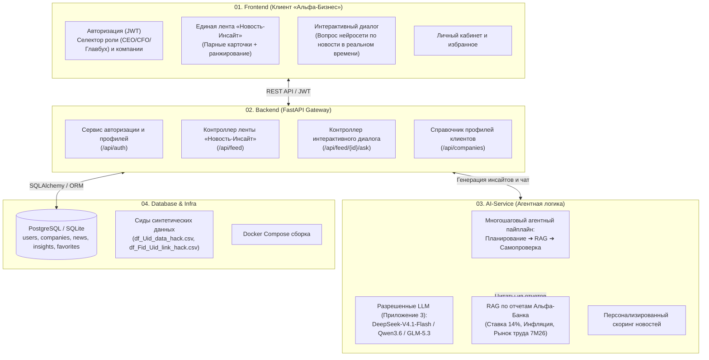

# Alfa News Insights 📰 🔴 🤖

> **Интеллектуальный сервис новостной аналитики для принятия бизнес-решений крупного и среднего бизнеса в экосистеме «Альфа-Бизнес».**  
> Разработано в рамках хакатона **«Альфа Будущее» (Changellenge >> & АО «Альфа-Банк»)**.

Сервис решает ключевую проблему руководителей: избавляет от бесконечного инфошума и вместо простого пересказа событий предоставляет **единую ленту спаренных карточек «Новость-Инсайт»**, где каждое внешнее событие моментально сопоставляется с контекстом конкретной компании и экспертной макроаналитикой Альфа-Банка.

---

## 💡 Концепция «Новость-Инсайт»

По регламенту кейса сервис не должен быть обычной новостной лентой. Пользователь видит поток готовых решений, где новость и персонализированный инсайт неразделимы:

```text
┌────────────────────────────────────────────────────────────────────────────────────────┐
│  НОВОСТЬ (Факт)                       │  ИНСАЙТ (Персонализация под контекст компании) │
│                                       │                                                │
│  «ЦБ РФ сохранил ключевую ставку 14%» │  • Почему важно: у вас 1.2 млрд ₽ кредитов     │
│  Совет директоров Банка России принял │  • Риски: долговая нагрузка не снизится        │
│  решение сохранить ставку на фоне...  │  • Оценка Альфа-Банка: «Период жесткой ДКП»    │
│  Источник: ЦБ РФ | 11 сентября        │  • Рекомендация: замещение факторингом банка   │
│                                       │  [💬 Спросить нейросеть]  [⭐ В избранное]      │
└────────────────────────────────────────────────────────────────────────────────────────┘
```

Каждая карточка закрывает **6 обязательных вопросов качественной интерпретации (стр. 14 ТЗ)**:
1. **Что произошло?** — объективные факты, цифры, участники и сроки без домыслов.
2. **Почему это важно для этой компании?** — связь с отраслью (ОКВЭД), масштабом выручки, импортом (`FTS_FLAG`), кредитами (`CL_PRODUCT_LOA_MARK`) и контрагентами.
3. **Какие последствия возможны?** — оценка потенциальных рисков и новых возможностей.
4. **Какие действия релевантны?** — прикладные шаги для руководителя компании.
5. **Как это оценивает банк?** — официальная позиция аналитиков Альфа-Банка с точной ссылкой на отчет и страницу.
6. **На чем основан вывод?** — прозрачная трассируемость (источники, сработавшие признаки клиента).

---

## 🏛 Архитектура проекта



---

## 👥 Структура проекта (4 рабочих пространства)

Репозиторий строго распределен на 4 независимые папки под команду из 4 человек:

```text
Alfa_Hack/
├── 01-frontend/         # Участник 1: Frontend Developer
│   ├── README.md        # UI/UX, единая лента «Новость-Инсайт», авторизация, чат
│   ├── Dockerfile       # сборка Vite → nginx (проксирование /api)
│   └── nginx.conf
│
├── 02-backend/          # Участник 2: Backend Developer
│   ├── README.md        # API ленты /api/feed, JWT auth, роуты, безопасность
│   ├── Dockerfile       # FastAPI :8000
│   └── app/             # auth.py, feed.py, ai_client.py, store.py, mock_ai.py
│
├── 03-ai-service/       # Участник 3: AI / ML Engineer
│   ├── README.md        # FastAPI :8001 — инсайты (LangGraph), чат, скоринг, сбор новостей, RAG
│   ├── Dockerfile       # python:3.12 + Tesseract OCR + uv
│   ├── src/ai_service/  # agent/ rag/ ingest/ scoring/ llm/ api/
│   ├── evals/           # golden-набор и eval-гейт
│   └── scripts/check.sh # ruff + mypy + pytest
│
├── 04-infra-db/         # Участник 4: DevOps & Database Engineer
│   ├── README.md        # Схема БД, сиды из датасетов кейса
│   ├── init.sql         # DDL PostgreSQL (компании, новости, инсайты, аудит)
│   ├── schema.sql       # универсальная ANSI SQL схема
│   ├── seed.py          # сидирование эталонными данными
│   └── samples/         # компактные JSON-сэмплы из CSV кейса
│
├── docker-compose.yml   # единый запуск: frontend + backend + ai-service
├── .env.example         # переменные окружения (JWT, LLM-модели, порты)
├── .gitignore           # исключения кэша, данных и секретов
├── THIRD_PARTY_NOTICES.md # перечень сторонних библиотек, моделей и датасетов
└── README.md            # главная документация проекта
```

---

## 🎯 Ролевая персонализация (Человек, а не только юрлицо)

В соответствии со стр. 5 ТЗ сервис создается для конкретных людей с разными информационными потребностями. В шапке интерфейса предусмотрен мгновенный переключатель роли:

| Роль пользователя | Фокус в ленте «Новость-Инсайт» | Пример реакции на новость |
|---|---|---|
| **CEO / Собственник** | Рыночные возможности, экспансия, конкуренты | Подсветка новых ниш и объемов рынка |
| **CFO / Казначей** | Маржинальность, кредитная нагрузка, процентные ставки | Анализ стоимости долга и альтернатив (факторинг, депозиты) |
| **Главный бухгалтер** | Налоговые риски, кадры, ФОТ, регуляторные изменения | Анализ рынка труда (отчет 7М26), риски проверок и штат |

---

## 🤖 Агентная логика и разрешенные LLM

### Пайплайн агента (стр. 7 ТЗ):
1. **Планирование**: сопоставление темы новости с отраслевым профилем клиента.
2. **Работа с инструментами**: вызов `CompanyProfileTool`, `AlfaRAGTool` (поиск по макроотчетам банка) и графовых связей.
3. **Единый контекст**: сохранение цепочки фактов и признаков компании.
4. **Самопроверка и адаптация**: отсечение галлюцинаций и проверка непротиворечивости выводов.

### Модели (Приложение 3 ТЗ):
- `DeepSeek-V4.1-Flash` — глубокий аналитический скоринг и трассировка связей;
- `Qwen3.6 35B A3B` — генерация текста инсайтов и рекомендаций;
- `GLM-5.3-Flash` — логическая валидация гипотез;
- `Gemma 4 26B A4B` — быстрая первичная фильтрация и классификация новостей.

---

Текущий набор: **Gemma** — планирование и классификация, **Qwen3.6** — инсайты и чат,
**GLM** — проверка. Настройки отклоняют модели вне списка из 6 разрешённых ID.
Для коротких ответов reasoning по умолчанию отключён: иначе thinking-токены могут
исчерпать лимит до завершения JSON. Лимиты согласованы: 120 с для инсайта, 130 с
для вызова из backend. Бюджет ключа общий для команды — 500 ₽/день; сброс в 03:00 МСК
по инструкции организаторов.

## 🔌 Основные API эндпоинты

| Метод | Путь | Описание |
|---|---|---|
| `POST` | `/api/auth/register` | Регистрация нового аккаунта |
| `POST` | `/api/auth/login` | Вход и получение JWT-токена |
| `GET` | `/api/auth/me` | Профиль пользователя и активная роль |
| `GET` | `/api/companies` | Список компаний для демо-селектора |
| `GET` | `/api/feed` | **Единая лента «Новость-Инсайт»** (фильтрация по роли и компании) |
| `GET` | `/api/feed/{id}` | Детальная карточка новость-инсайт |
| `POST` | `/api/feed/{id}/ask` | Интерактивный диалог: вопрос нейросети по новости |
| `POST` | `/api/feed/{id}/favorite` | Добавление карточки в избранное |

### AI-сервис (`03-ai-service`, порт 8001, вызывается backend'ом)

| Метод | Путь | Описание |
|---|---|---|
| `POST` | `/v1/insight` | Инсайт по 6 вопросам ТЗ + карточка в формате backend + трассировка |
| `POST` | `/v1/ask` | Ответ на вопрос по карточке с источниками |
| `POST` | `/v1/score` | Оценка важности новостей для компании и роли |
| `POST` | `/v1/news/collect` | Сбор и нормализация новостей из RSS |
| `GET` | `/v1/reports`, `/v1/reports/search` | Проиндексированные отчёты банка и поиск по ним |

Контракт: `specs/001-ai-service/contracts/openapi.yaml`; интеграция с backend —
`specs/001-ai-service/contracts/backend-integration.md`.

---

## 🚀 Быстрый старт

### 1. Клонирование репозитория
```bash
git clone https://github.com/bboymonster/Alfa_Hack.git
cd Alfa_Hack
```

### 2. Запуск через Docker Compose (Рекомендуемый способ для жюри)

Единый воспроизводимый запуск всех компонентов — корневой `docker-compose.yml`:

```bash
cp .env.example .env          # необязательно: есть безопасные значения по умолчанию
docker compose up --build -d
```

Сервисы будут доступны по адресам:

| Сервис | Адрес | Назначение |
|---|---|---|
| **Frontend** | `http://localhost:3000` | интерфейс «Альфа-Бизнес» (лента «Новость-Инсайт») |
| **Backend (Swagger)** | `http://localhost:8000/docs` | FastAPI: авторизация, лента, чат, избранное |
| **AI-service (Swagger)** | `http://localhost:8001/docs` | агентная логика: инсайты, чат, скоринг, RAG, сбор новостей |

Тестовые учетные записи предзаполнены:

| Логин | Пароль | Роль | Компания |
|---|---|---|---|
| `alfa-hack-2026` (аккаунт жюри) | `password123` | CEO | `U_1595` |
| `ceo@alfabusiness.ru` | `password123` | CEO | `U_1595` |
| `cfo@alfabusiness.ru` | `password123` | CFO | `U_1595` |
| `accountant@alfabusiness.ru` | `password123` | Главный бухгалтер | `U_1595` |

**Режимы AI-сервиса.** Без ключа `AI_LLM_API_KEY` сервис работает в режиме
`offline` — детерминированные инсайты с трассировкой агента (карточки помечаются
«демо / без LLM»). Чтобы включить реальные модели из Приложения 3 ТЗ, укажите в
`.env` ключ команды (`AI_LLM_API_KEY`). Адрес шлюза и точные модели уже
настроены по [инструкции организаторов](https://docs.google.com/document/d/1ly8GsI_-oPnCQWvtZ4nGevnnDP2MGYIfpn2zOUFxZ_4/edit).
Ключ используется только AI-сервисом, не попадает в frontend или Git.

**Корпус отчётов Альфа-Банка (опционально, для цитат банка).** Положите PDF-отчёты
из материалов кейса в `articles/` (9 файлов) и постройте индекс один раз:

```bash
docker compose exec ai-service ai-service index-reports
```

После этого в карточках появится поле «Как это оценивает Альфа-Банк» с дословной
цитатой и страницей отчёта. Индекс сохраняется в volume `alfa_ai_index`; без него
сервис продолжает работать (позиция банка помечается как «не найдена»).

### 3. Локальная разработка по модулям
- [01-frontend/README.md](01-frontend/README.md) — клиентское приложение (React / Vite)
- [02-backend/README.md](02-backend/README.md) — серверный API (FastAPI)
- [03-ai-service/README.md](03-ai-service/README.md) — агентная логика и промпты (Python)
- [04-infra-db/README.md](04-infra-db/README.md) — база данных и инфраструктура

---

## ✅ Пошаговый сценарий проверки (end-to-end)

1. **Вход.** Откройте `http://localhost:3000`, войдите как `alfa-hack-2026` /
   `password123` (или `ceo@alfabusiness.ru` и т.д. для другой роли).
2. **Смена клиента.** В шапке выберите компанию (`U_1595` — ритейл, `U_1465` —
   импорт напитков, `DEMO_LOCAL` — малый бизнес) — лента перестроится под контекст
   компании.
3. **Смена роли.** Переключите роль CEO → CFO → Главный бухгалтер — карточки
   переранжируются, а фокус интерпретации и рекомендации изменятся.
4. **Карточка «Новость-Инсайт».** Сначала видны короткий вывод (до 210 символов) и
   следующий шаг (до 140). Нажмите «Подробный анализ» — откроются 6 обязательных вопросов: факты (Q1),
   «почему важно» (Q2), риски и возможности (Q3), действия (Q4), позиция банка
   (Q5), основание вывода + сработавшие признаки и шаги агента (Q6).
5. **Диалог.** Нажмите «Спросить нейросеть» и задайте уточняющий вопрос — ответ
   приходит с трассировкой источников.
6. **Избранное.** Добавьте карточку в избранное и отфильтруйте ленту по кнопке
   «★ Избранное».
7. **Swagger.** Для технической проверки откройте `http://localhost:8000/docs`
   (backend) и `http://localhost:8001/docs` (AI-service).

---

## 🌐 Развёртывание на бесплатном хостинге (опционально)

Для статической демонстрации подготовлен GitHub Actions-воркфлоу
[`.github/workflows/deploy-pages.yml`](.github/workflows/deploy-pages.yml): он собирает
`01-frontend` (Vite, `base: './'`) и публикует `dist/` на GitHub Pages.

- Фронтенд собран с относительными путями, поэтому работает и на проектном сайте
  `https://<user>.github.io/Alfa_Hack/`.
- Сборка Pages использует `VITE_DEMO_MODE=true` и **автономный демо-режим**
  (`src/demoData.js`): вход, смена компании и роли, чат и избранное работают в браузере.
- Включение: в репозитории `Settings → Pages → Source: "GitHub Actions"`.

⚠️ Бесплатные GitHub Pages доступны для **публичных** репозиториев. Для приватного
репозитория Pages требует платный план (GitHub Pro/Team) — в этом случае можно либо
временно открыть репозиторий, либо развернуть статику на любом другом бесплатном
хостинге (Netlify, Vercel, Cloudflare Pages) командой сборки `npm ci && npm run build`
из папки `01-frontend`.

## Обновление от 26 октября 2026

Светлая палитра в духе Альфа-Бизнеса, локальный Golos Text, короткие раскрывающиеся
инсайты, поиск и фильтр по темам. Реальное API проверено через шлюз организаторов.
[Что проверено и промпт для следующего участника](docs/TEAM_HANDOFF.md).

Встроенные новости остаются демонстрационными даже при `insight.mode=llm`.
В интерфейсе различаются «Демо · без LLM» и «Вывод AI · демо-новость».
Отчёты банка не появляются без загрузки PDF и индексации корпуса.
