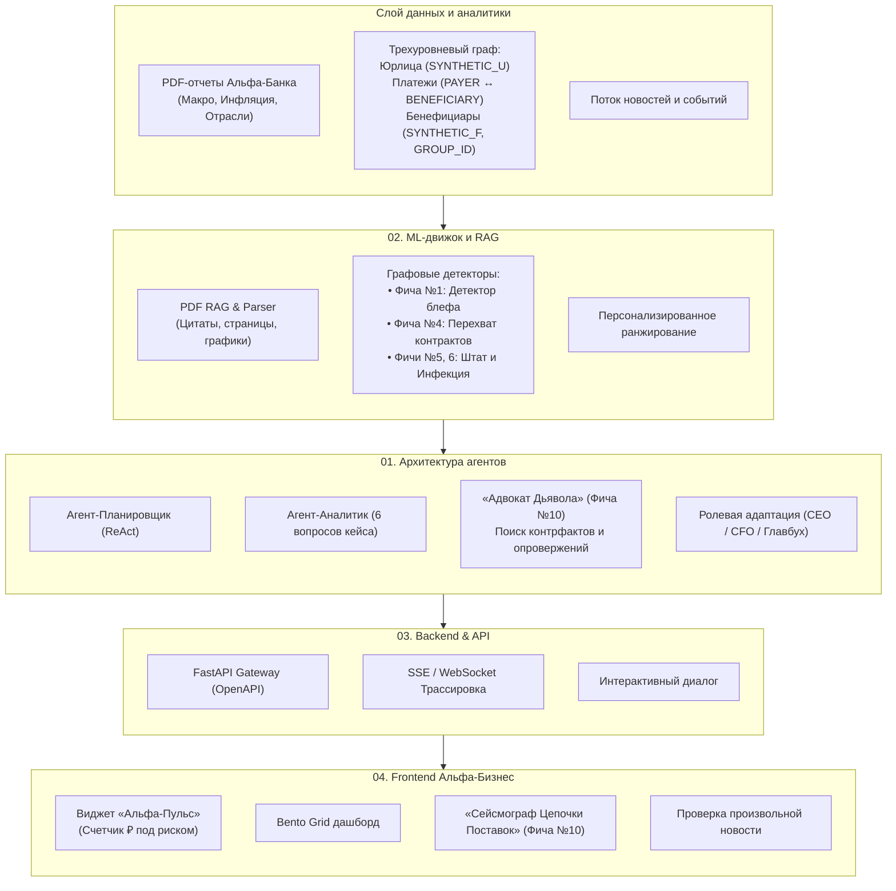

# Альфа-Пульс / Радар рисков и сделок 🔴

> **Интеллектуальная мультиагентная B2B-система раннего предупреждения рисков и захвата рыночных возможностей для клиентов «Альфа-Бизнеса».**

Система объединяет официальную макроаналитику Альфа-Банка, трехуровневый транзакционный граф контрагентов и мультиагентный ИИ с функцией самопроверки («Адвокат Дьявола») для превращения внешнего новостного шума в аргументированные финансовые решения в рублях.

---

## 🏛 Архитектура системы



---

## 🚀 Ключевые фичи и бизнес-логика

### 1. Фундамент: Фича №10 («Сейсмограф Цепочки Поставок» + «Адвокат Дьявола»)
- **Сейсмограф**: Интерактивная визуализация графа компании и ее контрагентов с распространением «ударной волны» новости, оценкой уязвимости каждого узла и подсчетом финансового объема под угрозой (`PAY_AMT`).
- **«Адвокат Дьявола»**: Агент-скептик, запускающий принудительную самопроверку гипотез. Ищет в отчетах Альфа-Банка и профиле клиента аргументы против первоначального прогноза и формирует блок: *«Контрфакты и условия, при которых прогноз не сбудется»*. Полная трассируемость рассуждений.

### 2. Главный бизнес-удар: Фича №1 + Фича №4 (Единый алгоритм обхода графа)
Обе фичи используют обход графа `PAYER ↔ BENEFICIARY` и сопоставление признаков контрагента с макроотчетами банка (`Inflation_tracker_02.pdf`, `ALFA-Macro_Insights-Policy_Rate_11Sep.pdf`):
- **Защита маржи — Фича №1 («Детектор Блефа Поставщика»)**:
  - Разоблачает контрагентов, повышающих цены под предлогом макроэкономики, валютных колебаний или ставки ЦБ, когда у них нет импорта (`FTS_FLAG == 0`) и кредитной нагрузки (`CL_PRODUCT_LOA_MARK == 0`).
  - Рассчитывает объективный ценовой потолок и сумму экономии компании в рублях.
- **Захват рынка — Фича №4 («Перехват Чужих Контрактов»)**:
  - Находит в графе крупных региональных покупателей, чьи текущие поставщики уязвимы (закредитованы или зависят от проблемных стран по данным ФТС).
  - Предлагает заместить поставщика с предодобренной банковской гарантией (`CL_PRODUCT_GAR_MARK`) или факторингом.

### 3. Пасхалки из датасета (Быстрые детерминированные проверки)
- **Фича №5 («Детектор Фантомного Штата»)**: Сверка расхождений численности сотрудников между базами ФНС и СПАРК с наложением аналитики рынка труда (`ALFA-7M26.pdf`) для выявления налоговых рисков и фирм-однодневок.
- **Фича №6 («Теневая Инфекция Бенефициаров»)**: Мониторинг кассовых разрывов и судебных рисков у смежных бизнесов с общими бенефициарами (`SYNTHETIC_F` и `GROUP_ID`).
- **Фича №8 («Индекс Стадного Иммунитета»)**: Нативная когортная статистика проникновения продуктов банка по сегментам ОКВЭД и выручки вместо навязчивой баннерной рекламы.

### 4. Опциональный бонус для питча: Фича №3 («Машина Времени»)
- Демо-тумблер сопоставления ретро-прогноза из архивного отчета 2021 года (`ALFA_Russian_Steels_1K21PreviewUpdate_15Apr2021.pdf`) со свежими отчетами 2026 года (`FI_Strategy_3Q26_22072026.pdf`, `Бонд_Бриф_14092026.pdf`), подтверждающий высокую точность аналитики банка на историческом горизонте.

---

## 🎨 Визуальный стиль и UX (Альфа-Бизнес)

| Элемент | Описание решения |
|---|---|
| **Точка входа** | Постоянный виджет-индикатор **«Альфа-Пульс / Радар рисков и сделок»** на главном экране интернет-банка со счетчиком критических событий и общей суммой под риском / к захвату в рублях. |
| **Ролевая персонализация** | Быстрый переключатель в шапке: **CEO / Собственник**, **CFO / Казначей**, **Главный бухгалтер**. Акценты автоматически перестраиваются: CEO видит «Перехват контрактов», CFO — «Блеф поставщиков», Главбух — «Фантомный штат» и субсидиарные риски. |
| **Цветовая трассировка** | Внутри карточек инсайтов контент строго разделен тремя бейджами: `[Факт (Первоисточник)]`, `[Позиция Альфа-Банка]` (кликабельная ссылка на отчет и страницу), `[Вывод ИИ-агента]` (сработавшие признаки компании). |
| **Эстетика** | Корпоративный минимализм Альфа-Банка: контрастная сетка **Bento Grid**, темный графитовый или чистый светлый фон, фирменный красный акцент (`#EF3124`) только для критических угроз и целевых кнопок. |
| **Живое демо** | Поле ввода произвольной новости в реальном времени с мгновенным пересчетом графа и выводов. |

---

## 👥 Структура проекта и распределение зон ответственности

Проект разбит на 4 изолированных рабочих пространства для параллельной разработки:

```text
Alfa_Hack/
├── 01-ai-agents/            # Архитектор ИИ-агентов & Продукт
│   ├── README.md            # Задачи, контракты и план агентов
│   └── ...                  # ReAct-пайплайн, Адвокат Дьявола, промпты ролей
│
├── 02-ml-graph-rag/         # ML-инженер (Графовый движок, RAG, детекторы)
│   ├── README.md            # Спецификация алгоритмов и PDF-индекса
│   └── ...                  # Граф (SYNTHETIC_U/F), парсинг отчетов, фичи 1, 4, 5, 6, 8, 3
│
├── 03-backend-gateway/      # Fullstack / Интегратор (API, Инфраструктура)
│   ├── README.md            # Спецификация API, контракты OpenAPI, профили
│   └── ...                  # FastAPI, стриминг шагов (SSE), чат, docker-compose
│
├── 04-frontend-ui/          # Frontend / UI (Интерфейс Альфа-Бизнес)
│   ├── README.md            # Архитектура UI, компоненты Bento Grid
│   └── ...                  # Виджет Альфа-Пульс, Сейсмограф, карточки фич
│
├── .gitignore               # Исключения репозитория (данные, кэши, секреты)
└── README.md                # Главная документация проекта
```

---

## 📅 Распределение задач на 6 дней

### Роль 1. Архитектор ИИ-агентов, Продукт (`01-ai-agents`)
- **День 1-2**: Проектирование многошагового агентного пайплайна (планирование шагов, вызовы инструментов графа и аналитики банка).
- **День 3**: Реализация «Адвоката Дьявола» (Фича №10) — логика контрфактов и сценариев опровержения.
- **День 4**: Сборка сценариев интерпретации по 6 ключевым вопросам кейса с жестким JSON-форматом.
- **День 5**: Ролевая адаптация (CEO / CFO / Главбух) и продуктовая интеграция «Стадного иммунитета» (Фича №8).
- **День 6**: Аудит безопасности вызовов, сквозной демо-сценарий и упаковка защиты.

### Роль 2. ML-инженер — Графовый движок, Парсинг и RAG (`02-ml-graph-rag`)
- **День 1**: Парсинг аналитических PDF-отчетов банка с сохранением метаданных (страницы, графики, таблицы) и новостей.
- **День 2**: Сборка трехуровневого графа данных: Юрлица (`SYNTHETIC_U`) ↔ Платежи (`PAY_AMT`) ↔ Бенефициары (`SYNTHETIC_F`, `GROUP_ID`).
- **День 3**: Алгоритмы для Фичи №1 («Детектор блефа») и Фичи №4 («Перехват контрактов»).
- **День 4**: Реализация детектора расхождений штата (Фича №5), инфекции бенефициаров (Фича №6) и агрегатора (Фича №8).
- **День 5**: Механизм персонализированного скоринга новостей и демо-тумблер «Машина времени» (Фича №3).
- **День 6**: Тестирование инструментов, профилирование и передача в Backend.

### Роль 3. Fullstack / Интегратор — API, Трассировка, Инфраструктура (`03-backend-gateway`)
- **День 1-2**: Проектирование OpenAPI контрактов, настройка FastAPI сервиса и слоя данных.
- **День 3**: Реализация стриминга промежуточных шагов рассуждения агентов (SSE/WebSocket) для трассируемости.
- **День 4**: Интерактивный чат внутри карточек событий и дозапрос дополнительного контекста.
- **День 5**: Сборка 3–4 выразительных демонстрационных профилей клиентов со сменой графа и новостей.
- **День 6**: Финализация `docker-compose.yml`, фиксация lock-файлов, `THIRD_PARTY_NOTICES`, развертывание стенда.

### Роль 4. Frontend / UI — Интерфейс Альфа-Бизнеса (`04-frontend-ui`)
- **День 1-2**: Верстка оболочки интернет-банка Альфа-Бизнес, виджета «Альфа-Пульс» и селектора ролей/компаний.
- **День 3**: Интерактивный визуализатор «Сейсмограф Цепочки Поставок» (Фича №10) с подсветкой волн риска.
- **День 4**: Спец-карточки фич: шкала «Детектора блефа» (№1), карточка «Перехвата контрактов» (№4), когортный бенчмарк (№8).
- **День 5**: Блок «Адвоката Дьявола», панель трассировки с бейджами и форма ввода произвольной новости.
- **День 6**: UI-полишинг в стиле Bento Grid, интеграция со стримингом бэкенда, генеральная репетиция демо.

---

## 🛠 Технологический стек

- **AI & Agents**: LangChain / LangGraph, Pydantic, Structured Output, Prompt Chaining.
- **Graph & ML**: NetworkX / PyG, Pandas, NumPy, Scikit-learn, FAISS / ChromaDB, PyPDF / pdfplumber.
- **Backend**: Python 3.11+, FastAPI, Uvicorn, SSE / WebSockets, Docker, Docker Compose.
- **Frontend**: Next.js / React, TypeScript, Tailwind CSS, Lucide Icons, Force-Graph / D3.js.

---

## 🏁 Быстрый старт (Разработка)

```bash
# Клонирование репозитория
git clone https://github.com/bboymonster/Alfa_Hack.git
cd Alfa_Hack

# Настройка виртуального окружения (Python)
python -m venv .venv
source .venv/bin/activate  # Для Windows: .venv\Scripts\activate

# Переход в интересующий модуль для локальной работы:
cd 01-ai-agents        # Работа над агентами
cd ../02-ml-graph-rag  # Работа над графом и RAG
cd ../03-backend-gateway # Работа над API и инфраструктурой
cd ../04-frontend-ui   # Работа над интерфейсом
```
