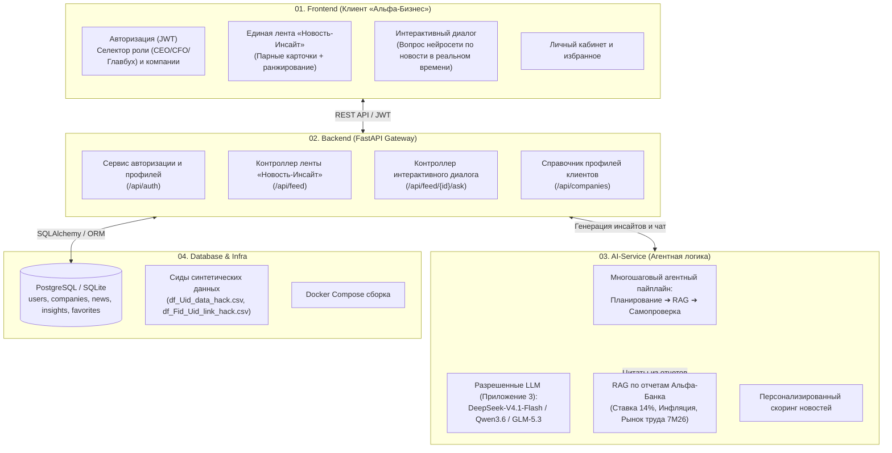

# Alfa News Insights 📰 🔴 🤖

> **Интеллектуальный сервис новостной аналитики для принятия бизнес-решений крупного и среднего бизнеса в экосистеме «Альфа-Бизнес».**  
> Разработано в рамках хакатона **«Альфа Будущее» (Changellenge >> & АО «Альфа-Банк»)**.

Сервис решает ключевую проблему руководителей: избавляет от бесконечного инфошума и вместо простого пересказа событий предоставляет **единую ленту спаренных карточек «Новость-Инсайт»**, где каждое внешнее событие моментально сопоставляется с контекстом конкретной компании и экспертной макроаналитикой Альфа-Банка.

---

## 💡 Концепция «Новость-Инсайт»

По регламенту кейса сервис не должен быть обычной новостной лентой. Пользователь видит поток готовых решений, где новость и персонализированный инсайт неразделимы:

```text
┌────────────────────────────────────────────────────────────────────────────────────────┐
│  НОВОСТЬ (Факт)                       │  ИНСАЙТ (Персонализация под контекст компании) │
│                                       │                                                │
│  «ЦБ РФ сохранил ключевую ставку 14%» │  • Почему важно: у вас 1.2 млрд ₽ кредитов     │
│  Совет директоров Банка России принял │  • Риски: долговая нагрузка не снизится        │
│  решение сохранить ставку на фоне...  │  • Оценка Альфа-Банка: «Период жесткой ДКП»    │
│  Источник: ЦБ РФ | 11 сентября        │  • Рекомендация: замещение факторингом банка   │
│                                       │  [💬 Спросить нейросеть]  [⭐ В избранное]      │
└────────────────────────────────────────────────────────────────────────────────────────┘
```

Каждая карточка закрывает **6 обязательных вопросов качественной интерпретации (стр. 14 ТЗ)**:
1. **Что произошло?** — объективные факты, цифры, участники и сроки без домыслов.
2. **Почему это важно для этой компании?** — связь с отраслью (ОКВЭД), масштабом выручки, импортом (`FTS_FLAG`), кредитами (`CL_PRODUCT_LOA_MARK`) и контрагентами.
3. **Какие последствия возможны?** — оценка потенциальных рисков и новых возможностей.
4. **Какие действия релевантны?** — прикладные шаги для руководителя компании.
5. **Как это оценивает банк?** — официальная позиция аналитиков Альфа-Банка с точной ссылкой на отчет и страницу.
6. **На чем основан вывод?** — прозрачная трассируемость (источники, сработавшие признаки клиента).

---

## 🏛 Архитектура проекта



---

## 👥 Структура проекта (4 рабочих пространства)

Репозиторий строго распределен на 4 независимые папки под команду из 4 человек:

```text
Alfa_Hack/
├── 01-frontend/         # Участник 1: Frontend Developer
│   ├── README.md        # UI/UX, единая лента «Новость-Инсайт», авторизация, чат
│   └── .gitkeep
│
├── 02-backend/          # Участник 2: Backend Developer
│   ├── README.md        # API ленты /api/feed, JWT auth, роуты, безопасность
│   └── .gitkeep
│
├── 03-ai-service/       # Участник 3: AI / ML Engineer
│   ├── README.md        # FastAPI :8001 — инсайты (LangGraph), чат, скоринг, сбор новостей, RAG
│   ├── src/ai_service/  # agent/ rag/ ingest/ scoring/ llm/ api/
│   ├── evals/           # golden-набор и eval-гейт
│   └── scripts/check.sh # ruff + mypy + pytest
│
├── 04-infra-db/         # Участник 4: DevOps & Database Engineer
│   ├── README.md        # Схема БД, сиды из датасетов кейса, docker-compose
│   └── .gitkeep
│
├── .env.example         # Переменные окружения (БД, JWT, разрешенные LLM)
├── .gitignore           # Исключения кэша, данных и секретов
├── THIRD_PARTY_NOTICES.md # Перечень сторонних библиотек, моделей и датасетов
└── README.md            # Главная документация проекта
```

---

## 🎯 Ролевая персонализация (Человек, а не только юрлицо)

В соответствии со стр. 5 ТЗ сервис создается для конкретных людей с разными информационными потребностями. В шапке интерфейса предусмотрен мгновенный переключатель роли:

| Роль пользователя | Фокус в ленте «Новость-Инсайт» | Пример реакции на новость |
|---|---|---|
| **CEO / Собственник** | Рыночные возможности, экспансия, конкуренты | Подсветка новых ниш и объемов рынка |
| **CFO / Казначей** | Маржинальность, кредитная нагрузка, процентные ставки | Анализ стоимости долга и альтернатив (факторинг, депозиты) |
| **Главный бухгалтер** | Налоговые риски, кадры, ФОТ, регуляторные изменения | Анализ рынка труда (отчет 7М26), риски проверок и штат |

---

## 🤖 Агентная логика и разрешенные LLM

### Пайплайн агента (стр. 7 ТЗ):
1. **Планирование**: сопоставление темы новости с отраслевым профилем клиента.
2. **Работа с инструментами**: вызов `CompanyProfileTool`, `AlfaRAGTool` (поиск по макроотчетам банка) и графовых связей.
3. **Единый контекст**: сохранение цепочки фактов и признаков компании.
4. **Самопроверка и адаптация**: отсечение галлюцинаций и проверка непротиворечивости выводов.

### Модели (Приложение 3 ТЗ):
- `DeepSeek-V4.1-Flash` — глубокий аналитический скоринг и трассировка связей;
- `Qwen3.6 35B A3B` — генерация текста инсайтов и рекомендаций;
- `GLM-5.3-Flash` — логическая валидация гипотез;
- `Gemma 4 26B A4B` — быстрая первичная фильтрация и классификация новостей.

---

## 🔌 Основные API эндпоинты

| Метод | Путь | Описание |
|---|---|---|
| `POST` | `/api/auth/register` | Регистрация нового аккаунта |
| `POST` | `/api/auth/login` | Вход и получение JWT-токена |
| `GET` | `/api/auth/me` | Профиль пользователя и активная роль |
| `GET` | `/api/companies` | Список компаний для демо-селектора |
| `GET` | `/api/feed` | **Единая лента «Новость-Инсайт»** (фильтрация по роли и компании) |
| `GET` | `/api/feed/{id}` | Детальная карточка новость-инсайт |
| `POST` | `/api/feed/{id}/ask` | Интерактивный диалог: вопрос нейросети по новости |
| `POST` | `/api/feed/{id}/favorite` | Добавление карточки в избранное |

### AI-сервис (`03-ai-service`, порт 8001, вызывается backend'ом)

| Метод | Путь | Описание |
|---|---|---|
| `POST` | `/v1/insight` | Инсайт по 6 вопросам ТЗ + карточка в формате backend + трассировка |
| `POST` | `/v1/ask` | Ответ на вопрос по карточке с источниками |
| `POST` | `/v1/score` | Оценка важности новостей для компании и роли |
| `POST` | `/v1/news/collect` | Сбор и нормализация новостей из RSS |
| `GET` | `/v1/reports`, `/v1/reports/search` | Проиндексированные отчёты банка и поиск по ним |

Контракт: `specs/001-ai-service/contracts/openapi.yaml`; интеграция с backend —
`specs/001-ai-service/contracts/backend-integration.md`.

---

## 🚀 Быстрый старт

### 1. Клонирование репозитория
```bash
git clone https://github.com/bboymonster/Alfa_Hack.git
cd Alfa_Hack
```

### 2. Запуск через Docker Compose (Рекомендуемый способ для жюри)
```bash
cp .env.example .env
docker compose up --build -d
```
Сервисы будут доступны по адресам:
- **Frontend (Интерфейс «Альфа-Бизнес»)**: `http://localhost:3000`
- **Backend Swagger API**: `http://localhost:8000/docs`
- **Тестовые учетные записи**: предзаполнены скриптом сидирования (`alfa-hack-2026` / `password123`).
- **AI-сервис**: `http://localhost:8001/docs`; после запуска один раз построить индекс
  отчётов: `cd 03-ai-service && uv run ai-service index-reports` (PDF в `03-ai-service/data/articles/`).

### 3. Локальная разработка по модулям
- [01-frontend/README.md](file:///c:/Projects/Alfa_Hack/01-frontend/README.md) — клиентское приложение (React / Next.js)
- [02-backend/README.md](file:///c:/Projects/Alfa_Hack/02-backend/README.md) — серверный API (FastAPI)
- [03-ai-service/README.md](file:///c:/Projects/Alfa_Hack/03-ai-service/README.md) — агентная логика и промпты (Python)
- [04-infra-db/README.md](file:///c:/Projects/Alfa_Hack/04-infra-db/README.md) — база данных и инфраструктура
